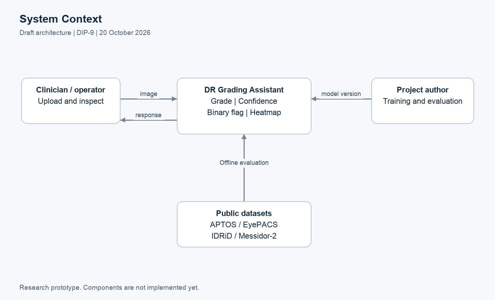
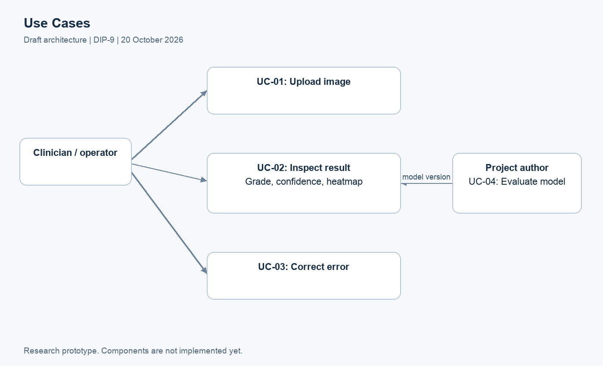
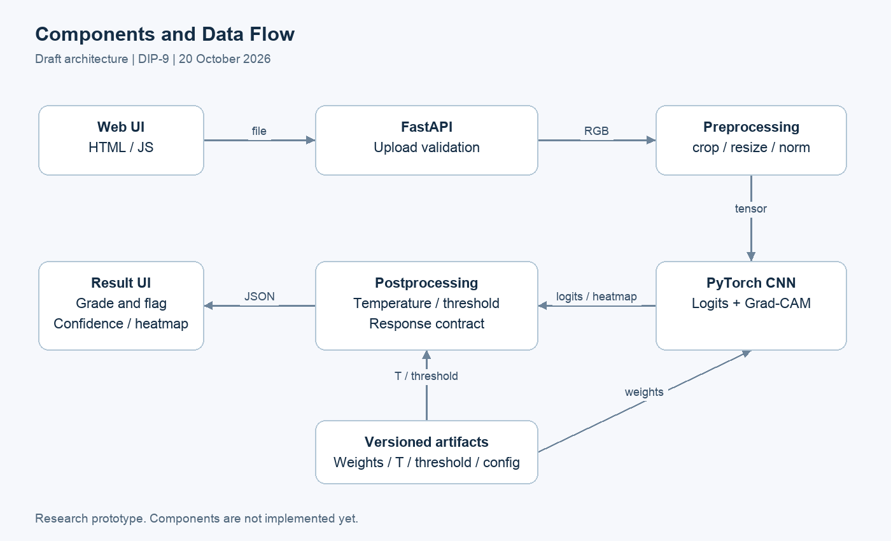

# 7. Architecture and Diagrams

DIP-9. Version 0.2, 20 October 2026. Draft architecture; software components have not been implemented.

## System Boundary

The system accepts one image and returns a research assessment. The author performs training/evaluation offline; user uploads do not trigger model updates. Health-information systems, patient registration and medical-record databases are excluded. The context does not imply access to clinical data.

## Use Cases

UC-01: select an allowed file, pass validation and wait for output. UC-02: inspect grade, binary flag and its limitation, confidence and heatmap. UC-03: correct a file after an explicit error without a stale result. UC-04: the author prepares data, evaluates and releases a model version. User interviews may change these scenarios.

## Components

Web UI sends a multipart request to FastAPI. Validation checks bytes, format and pixel limits. Preprocessing converts RGB to a tensor using the same configuration as training. The CNN returns logits; temperature scaling converts them into calibrated probabilities. Postprocessing computes grade=argmax and score=p2+p3+p4, comparing score with a fixed threshold. Grad-CAM requires activations/gradients from the same CNN. Map failure does not invalidate a correct main response.

Weights, temperature, threshold, class order and preprocessing rules form one versioned bundle with checksums. Keep images only in memory or a temporary directory with cleanup. Logs retain request_id, version, duration and error code without image contents. Concurrent training and inference in one process are not planned.

## Editable Sources and Exports

Mermaid .mmd files and editable geometry JSON are in diagrams/src/. PNG/SVG exports are in diagrams/export/. scripts/build_visuals.py generates SVG/PNG from JSON. Mermaid changes require matching JSON updates. These are architecture illustrations, not automatically generated UML models. Rebuilding requires Python, Pillow and Arial; the script specifies the macOS font path.
