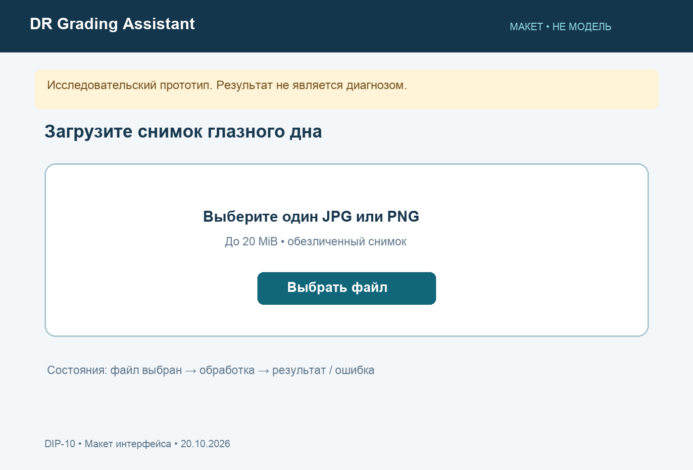
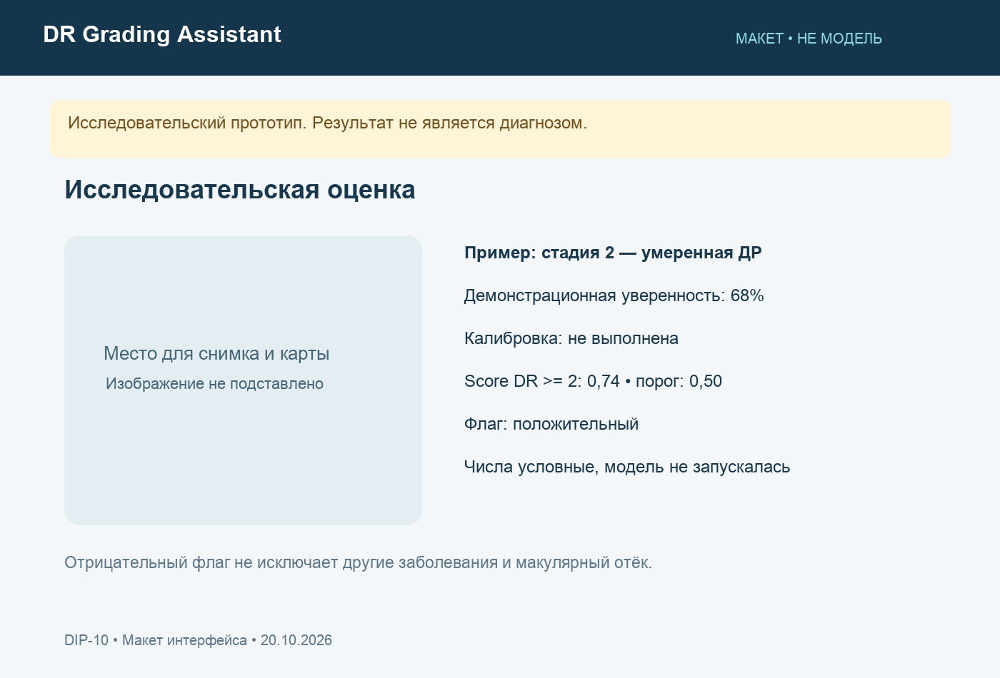
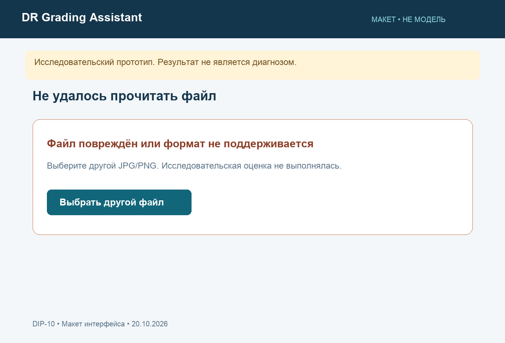

# 8. Макеты ключевых сценариев

DIP-10. 20.10.2026. Три схемных макета, не работающий ML-сервис. Числа на экране результата условные; модель не запускалась. Изображения пациента и искусственная карта Grad-CAM не подставлялись.

## Загрузка

Один файл, ограничение 20 MiB, явное исследовательское назначение. После выбора файла отображаются имя и возможность заменить его; во время анализа отправка блокируется. Анимация обработки описана как состояние будущей реализации.

## Результат

Стадия 0–4 показывается отдельно от бинарного score. В примере score=0,74 и условный порог 0,50, поэтому флаг положительный; производственный порог будет определён только на calibration. Условные вероятности примера: [0,06; 0,20; 0,68; 0,04; 0,02], сумма равна 1. Карта должна переключаться с исходным снимком после реализации FR-06. Уверенность обозначает выход модели, а не вероятность здоровья. Отрицательный флаг не исключает другие заболевания.

## Ошибка

Повреждённый файл не получает прогноза. Предлагается выбрать другой снимок. Отдельно в реализации потребуются ошибки лимита размера, недоступности модели и внутреннего сбоя. Ошибка декодирования не называется оценкой клинического качества снимка.

## Проверка макетов

Сценарии связаны с UC-01/02/03 и FR-01..08. Валидация с пользователями ещё не проведена. Следующая проверка: понятность бинарного флага, числовой уверенности и ограничений; работа клавиатурой и адаптация к 375 px проверяются после реализации интерфейса. Экспорты воспроизводятся scripts/build_visuals.py.
